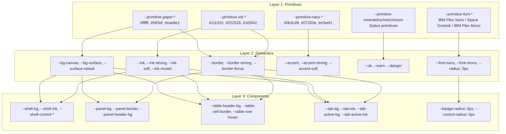

# ECE Accounting — Design System & ERP Architectural Record

**Document ID:** `FIN-AXIS-DESIGN-SPEC`  
**Archetype:** Swiss Industrial Print / Archival Accounting Ledger (`industrial-brutalist-ui`)  
**Target Workspace:** `/home/javvii/FreelanceProject/Project7/fin-axis/mockup`  
**ERP UX References (Jakob's Law):** SAP S/4HANA Fiori, Oracle Fusion Cloud Financials, Oracle NetSuite, Eye-share Workflow  

---

## 1. Executive Design Mandate & Brutalist Archetype

ECE Accounting is a multi-company Philippine accounting, payroll, and inventory operations system governed by 31 strict statutory/internal business rules (`BR-01` through `BR-31`) and 19 golden numerical verification scenarios (`G01` through `G19`).

To serve institutional finance practitioners who operate within financial ledgers for 8+ hour continuous shifts, ECE Accounting implements the **Swiss Industrial Print & Archival Accounting Ledger** brutalist visual system:
- **Daylight-First Archival Substrate:** The canvas sits on unbleached archival ledger paper (`--primitive-paper-100: #f4f3ef`), eliminating the halation eye-strain that pure `#000000` on `#ffffff` causes under high desktop brightness.
- **Pure Paper Data Sheets:** Operational panels, modal sheets, and data tables occupy pure white blocks (`--primitive-paper-000: #ffffff`) framed by stark mechanical hairlines (`1px solid #111315`).
- **Carbon Ink:** Typography renders in crisp carbon ink (`#111315` and `#08090a`), providing unambiguous contrast without typographic blurring.
- **Institutional Navy & Accents:** High-density accounting action triggers employ deep institutional navy (`--primitive-navy-800: #0b3c49`), while ledger statuses use semantic, high-contrast ochre (`#7a4f00`), emerald (`#14532d`), and crimson (`#991b1b`).

---

## 2. Anti-Slop Elimination Standards

ECE Accounting enforces strict visual hygiene to prevent generic AI-generated aesthetic patterns ("AI-slop"):

| Anti-Pattern | Brutalist Standard in ECE Accounting | System Implementation |
| :--- | :--- | :--- |
| **Overused Generic Fonts** (`"Inter"`, `"Roboto"`) | Institutional Grotesque & Monospace | `--primitive-font-sans`: `'IBM Plex Sans'`, `'Archivo'`, `'Helvetica Neue'`, Arial, sans-serif<br>`--primitive-font-display`: `'Space Grotesk'`, `'IBM Plex Sans'`, `'Arial Narrow'`<br>`--primitive-font-mono`: `'IBM Plex Mono'`, `'JetBrains Mono'`, ui-monospace |
| **Accent Borders on Rounded Tabs** (`border-bottom: 3px solid` on rounded pills) | Crisp Rectangular Work-Area Strips | Work-area strips (`.page-nav`, `.tab-row`) bounded by `1px solid var(--border-strong)`. Active tabs invert to `background: var(--tab-active-bg)` (`#111315`) with paper-white ink (`#ffffff`). Border-radius is strictly `0px`. |
| **Rounded Corners / Bubble Pills** (`border-radius: 999px`, `6px`, `4px`) | Strict 90-Degree Geometric Precision | Every component, button, input, badge, stamp, panel, dialog, and tile uses `border-radius: 0px` (`--radius: 0px`). |
| **Soft Atmospheric Drop Shadows** (`0 18px 50px rgba(...)`) | Solid Crisp Borders & Hard Mechanical Offsets | Inline cards/panels have `box-shadow: none`. Floating overlays (`.modal`, `.toast`, `.demo-panel`, `.apps-menu nav`) use crisp structural offset shadows (`--shadow-hard: 3px 3px 0 var(--primitive-ink-900)`). |
| **Raw Scattered Hex Literals** | 3-Layer Design Token Architecture | Zero hex literals in component rules. Every rule derives from primitive, semantic, or component CSS variables. |

---

## 3. 3-Layer CSS Custom Property Architecture

The design token system in `src/styles.css` follows a strict three-tier inheritance model:
`Layer 1: Primitive Tokens` → `Layer 2: Semantic Tokens` → `Layer 3: Component Tokens`.



### 3.1 Token Definitions

#### Layer 1: Primitive Tokens (`--primitive-*`)
- **Archival Paper & Ink:** `--primitive-paper-000` (`#ffffff`), `--primitive-paper-050` (`#f9f8f5`), `--primitive-paper-100` (`#f4f3ef`), `--primitive-paper-200` (`#eae8e1`), `--primitive-paper-300` (`#dcd9cf`), `--primitive-rule-400` (`#b8b4a8`), `--primitive-rule-600` (`#6e6b62`), `--primitive-ink-700` (`#3d3f42`), `--primitive-ink-800` (`#222528`), `--primitive-ink-900` (`#111315`), `--primitive-ink-950` (`#08090a`).
- **Institutional Navy:** `--primitive-navy-900` (`#07262e`), `--primitive-navy-800` (`#0b3c49`), `--primitive-navy-700` (`#125162`), `--primitive-navy-100` (`#e3eef1`), `--primitive-navy-050` (`#f1f6f8`).
- **Semantic Accents:**
  - Emerald: `--primitive-emerald-900` (`#0d3b20`), `--primitive-emerald-800` (`#14532d`), `--primitive-emerald-100` (`#dcfce7`), `--primitive-emerald-050` (`#f0fdf4`).
  - Ochre: `--primitive-ochre-900` (`#5c3b00`), `--primitive-ochre-800` (`#7a4f00`), `--primitive-ochre-100` (`#fef3c7`), `--primitive-ochre-050` (`#fffbeb`).
  - Crimson: `--primitive-crimson-900` (`#7f1d1d`), `--primitive-crimson-800` (`#991b1b`), `--primitive-crimson-100` (`#fee2e2`), `--primitive-crimson-050` (`#fef2f2`).
- **Typography:**
  - Sans: `'IBM Plex Sans', 'Archivo', 'Helvetica Neue', Arial, sans-serif`
  - Display: `'Space Grotesk', 'IBM Plex Sans', 'Arial Narrow', Arial, sans-serif`
  - Monospace: `'IBM Plex Mono', 'JetBrains Mono', ui-monospace, 'SFMono-Regular', Menlo, Consolas, monospace`
- **Spatial Grid:** `--primitive-space-1` (4px) through `--primitive-space-8` (32px).

#### Layer 2: Semantic Tokens
- **Surfaces:** `--bg`, `--bg-canvas` (`var(--primitive-paper-100)`), `--surface`, `--bg-surface` (`var(--primitive-paper-000)`), `--surface-raised` (`var(--primitive-paper-050)`), `--surface-muted` (`var(--primitive-paper-200)`), `--surface-inverse` (`var(--primitive-ink-900)`).
- **Ink:** `--ink` (`#111315`), `--ink-strong` (`#08090a`), `--ink-soft` (`#222528`), `--ink-muted` (`#3d3f42`), `--ink-inverse` (`#ffffff`).
- **Structural Rules:** `--border` (`var(--primitive-rule-400)`), `--border-subtle` (`var(--primitive-paper-300)`), `--border-strong` (`var(--primitive-ink-900)`), `--border-focus` (`var(--primitive-navy-800)`).
- **Accounting Actions:** `--accent` (`#0b3c49`), `--accent-strong` (`#07262e`), `--accent-soft` (`#e3eef1`), `--accent-tint` (`#f1f6f8`).
- **Ledger Status:** `--ok` / `--ok-bg` / `--ok-border`, `--warn` / `--warn-bg` / `--warn-border`, `--danger` / `--danger-bg` / `--danger-border`.
- **Geometry:** `--radius: 0px`, `--shadow-hard: 3px 3px 0 var(--primitive-ink-900)`.

#### Layer 3: Component Tokens
- **Shell:** `--shell-bg` (`#111315`), `--shell-ink` (`#ffffff`), `--shell-border` (`#08090a`), `--shell-control-bg` (`#222528`), `--shell-control-border` (`#6e6b62`), `--shell-stamp-bg` (`#fef3c7`), `--shell-stamp-ink` (`#08090a`).
- **Panels:** `--panel-bg` (`#ffffff`), `--panel-border` (`#111315`), `--panel-header-bg` (`#f9f8f5`).
- **Tables:** `--table-header-bg` (`#eae8e1`), `--table-header-ink` (`#08090a`), `--table-cell-border` (`#dcd9cf`), `--table-row-hover` (`#f1f6f8`).
- **Work-Area Tabs:** `--tab-bg` (`#f9f8f5`), `--tab-ink` (`#222528`), `--tab-active-bg` (`#111315`), `--tab-active-ink` (`#ffffff`), `--tab-border` (`#111315`).

---

## 4. Jakob's Law: ERP Floorplan Reference Systems

Financial software operators spend years inside enterprise software suites. Jakob's Law dictates that ECE Accounting must adopt the interaction ergonomics and floorplans familiar from standard financial systems:

### 4.1 SAP S/4HANA (Fiori 3 / Horizon Shell Bar & Launchpad Spaces)
- **Persistent Operational Bar (`.app-header`):** Anchored top-level bar (`position: sticky; top: 0; z-index: 30`) with brand emblem (`ECE`), wordmark (`ECE ACCOUNTING`), active company and module context, `All Apps` launcher, and high-visibility telemetry stamp (`SYNTHETIC DEMO`).
- **Launchpad Instrument Tiles (`.app-grid`, `.app-tile`):** High-density cards functioning as operational instruments:
  - Top title in Grotesque display font.
  - Operational purpose summary.
  - Real-time availability indicator (`AVAILABLE`, `READ-ONLY`, `NOT LICENSED`, `RESTRICTED`).
  - Subtle brutalist hover translation (`translate(-1px, -1px)`) with crisp `2px 2px 0 var(--border-strong)` mechanical offset shadow.

### 4.2 Oracle Fusion Financials (Work-Area Sub-Navigation & KPI Infolet Strips)
- **Work-Area Task Strips (`.page-nav`, `.tab-row`):** Strict rectangular segmented controls where each item is bounded by hairlines (`border-right: 1px solid var(--border)`). Active items invert to deep carbon (`#111315`) with stark paper ink (`#ffffff`).
- **Exposed 1px Ledger Summary Grid (`.stat-row`, `.stat`):** Financial summary strip built with an exposed `1px` grid (`background: var(--border-strong); gap: 1px; border: 1px solid var(--border-strong)`). Each infolet is a pure paper cell displaying an uppercase monospace label (`0.68rem`), large tabular figure (`font-family: var(--font-mono); font-variant-numeric: tabular-nums`), and status note.

### 4.3 Oracle NetSuite (Dense Ledger Grids & Master Record Coding)
- **Dense Ledger Views (`.table-wrap`, `.data-table`):** Compact vertical padding (`0.45rem 0.65rem`), explicit horizontal and vertical hairlines (`1px solid var(--table-cell-border)`), monospace uppercase column headers (`0.72rem`, `letter-spacing: 0.05em`), and right-aligned numeric cells in tabular figures.
- **Relational vs. Display Code Separation:** Immutable internal relational IDs (`acc-ws-a-1010`, `contact-a-cust-1`, `item-a-1`) remain immutable system keys, while public display codes provide clean operational scanning.

### 4.4 Eye-share Workflow (AP Queue & Disbursement Maker/Checker Ergonomics)
- **Rectangular Technical Framing for Status Stamps (`.badge`, `.flag`, `.save-state`):** Status is communicated through rectangular industrial stamps (`[ POSTED ]`, `[ PENDING APPROVAL ]`, `[ HELD ]`, `[ DRAFT ]`) using `1px solid` semantic borders, uppercase monospace typography, and high-contrast ink meeting WCAG 2.2 AA contrast requirements.

---

## 5. Master Data Coding Specification (The No-Dash Rule)

For all master data across Accounting, Payroll, Inventory, and Banking, **business codes must NEVER place a dash (`-`) between the assigned prefix initial and the sequence number.**

### 5.1 Master Data Kinds & Standard Sequences

| Domain | Master Record Kind (`RecordKind`) | Prefix Initial (`prefix`) | Start Number (`startNumber`) | Min Digits (`minDigits`) | Generated Code Examples | Prohibited Legacy Format |
| :--- | :--- | :--- | :--- | :--- | :--- | :--- |
| **Accounting** | `account` (Chart of Accounts) | `A` | `100` | `0` | `A100`, `A101`, `A102` | `ACCT-000200` |
| **Core / Admin** | `contact` (Customers & Vendors) | `C` | `100` | `0` | `C100`, `C101`, `C102` | `C-100` |
| **Payroll** | `employee` (Employees) | `""` (or `EMP`) | `5000` | `4` | `5000`, `5001` (or `EMP5000`) | `E-5000` |
| **Inventory** | `item` (Inventory Items) | `I` | `100` | `0` | `I100`, `I101`, `I102` | `I-100` |
| **Inventory** | `location` (Stock Locations) | `L` | `100` | `0` | `L100`, `L101` | `L-100` |
| **Accounting** | `asset` (Fixed Assets) | `FA` | `100` | `0` | **`FA100`, `FA101`** | **`FA-0001` (Dashed)** |
| **Accounting** | `bank_account` (Bank Accounts) | `B` | `100` | `0` | `B100`, `B101` | `B-100` |

### 5.2 Validation & Formatting Rules
1. **Master Prefix Regex:** Validation enforces `/^[A-Za-z0-9]{0,8}$/` for all master data kinds. Dashes (`-`), underscores (`_`), and special characters are rejected with `VALIDATION: Master data prefix must be 0 to 8 letters or digits without dashes.`
2. **Deterministic Number Formatting:** Sequence formatting concatenates prefix and padded sequence without introducing delimiters: `${prefix}${pad(nextNumber, minDigits)}`.
3. **Inventory SKUs:** Seeded item SKUs conform to the no-dash convention (`W100`, `S200`, `B100` instead of `W-100`, `S-200`, `B-100`).
4. **Item Master Display:** Inventory and stock valuation reports expose both the allocated `itemNo` (`I100`) and the external `sku` (`W100`).

---

## 6. Architecture & System Contracts

### 6.1 Hash Routing Contract
Typed hash route union without third-party routing dependencies:
```text
#/home
#/billing/invoices
#/billing/invoices/new
#/billing/invoices/<encoded-immutable-id>
#/payroll/employees
#/admin/numbering
#/other/journals/<encoded-immutable-id>
#/purchases/approvals?status=pending
```
- Legacy `#/module` routes redirect deterministically to the documented module default page.
- Unknown or corrupted routes render a dedicated brutalist recovery card (`.recovery-card`) with an authorized return action; they never silently open Billing.
- Record IDs in route paths remain immutable relational keys; display business codes are visual labels only.

### 6.2 Numbering Domain Service
Owned by `src/domain/numbering.ts`:
- Typed record-kind registry separating master kinds from transaction document kinds.
- Atomic counter advance within command draft transactions.
- Zero code consumption on failed validation, denied permissions, uncommitted preview, or idempotent retry.
- Compound commands see their own draft series state, preventing collision between dual journals.

### 6.3 State Migration & Integrity
- Pure, deterministic v1→v2 migration in `parseAppState` before runtime validation.
- Migration preserves internal IDs, historical codes, ledger balances, posted journal snapshots, source keys, and idempotency receipts.
- Raw invalid snapshots are retained in memory on failure and never silently cleared.

### 6.4 Accessibility Contract (WCAG 2.2 AA)
- **High Contrast:** All interactive chrome, text, and badges meet or exceed WCAG 2.2 AA contrast:
  - `.panel-sub` / `.panel`: `>= 4.5:1` (Measured: `10.3:1`)
  - `.field-hint` / `.panel`: `>= 4.5:1` (Measured: `10.3:1`)
  - `.brand-name` / `.app-header`: `>= 4.5:1` (Measured: `19.0:1`)
  - `.demo-stamp` / `.app-header`: `>= 4.5:1` (Measured: `17.0:1`)
  - `button.primary` text / background: `>= 4.5:1` (Measured: `11.8:1`)
- **Keyboard Traversal:** `:focus-visible` utilizes `2px solid var(--border-focus)` with `2px` offset.
- **Skip Link:** Landmark skip link focuses main content (`#main-content`) without altering hash route.
- **Dialog Ergonomics:** Modals trap focus, close on `Escape`, and restore focus to trigger element upon exit.
- **Zoom & Viewports:** Fully responsive from 320px mobile viewports through 200% browser zoom proxy without page-level horizontal overflow; wide tables scroll inside their container (`.table-wrap`).
- **Motion Guardrail:** Complete `@media (prefers-reduced-motion: reduce)` support resets animation and transition durations to `0.01ms`.
